# 소리책방 웹앱 설계 계획서

> 버전: **1.4 — 비용·브라우저 자원 최적화 반영본 (2026-10-28)**
> 상태: **기능 확장 구현 기준 문서**
> 원칙: 구현된 기능은 이 문서의 완료 기준과 테스트 항목을 함께 갱신한다.

## 1. 프로젝트 한 줄 정의

교사가 사용 권한이 있는 PDF·이미지 자료로 수업을 만들고, 학생이 이름 없이 교과서를 소리 내어 읽은 뒤 문제를 손글씨로 풀고 형성평가 피드백을 받는 GitHub Pages 기반 정적 웹앱이다.

가칭은 **소리책방**으로 정한다. 교과서의 “읽기 → 생각하기 → 손으로 답하기” 흐름을 화면의 중심에 둔다.

## 2. 인터뷰에서 확정된 사항

| 구분 | 결정 |
|---|---|
| 기본 학습 흐름 | 교과서 선택 → 낭독 → 정확도 확인 → 문제 풀이 → 손글씨 인식 → 피드백 |
| 교재 형식 | 텍스트 PDF, 스캔 PDF, JPG, PNG |
| 낭독 통과 기준 | 인식된 텍스트와 원문 일치율 70% 이상 |
| 재시도 | 첫 시도 70% 미만이면 한 번 더 읽고, 두 번째 결과와 관계없이 문제 풀이 허용 |
| 문제 생성 | 1차 버전은 규칙 기반 자동 생성, 이후 AI API 방식 추가 |
| 교사 검토 | 자동 생성된 문제·정답·핵심어를 교사가 수정한 뒤 배포 |
| 문제 유형 | 객관식, 짧은 단답형, 한두 문장 서술형, 교과서 이미지 퍼즐 |
| 손글씨 입력 | 마우스·손가락·펜 모두 지원 |
| 인식 오류 처리 | 인식된 텍스트를 학생이 직접 확인·수정한 뒤 제출 |
| 서술형 평가 | 핵심어 포함 여부와 모범 답안 유사도를 함께 사용 |
| 학생 식별 | 반·번호만 입력하고 임의 식별자는 앱이 자동 생성. 반·번호가 있으므로 완전한 익명은 아니며 `가명 처리`로 표현 |
| 위치 기록 | 문제 풀이 화면에서만 이동·클릭·터치 위치 기록 |
| 결과 제출 | JSON 파일 다운로드 + JSON 내용 복사 버튼 |
| 교재 공유 | 교사가 수업 폴더를 GitHub 저장소에 올리고 수업별 링크 공유 |
| 화면 범위 | 교사용 제작 화면과 학생용 학습 화면 모두 포함 |
| 교사 접근 | 간단한 비밀번호 사용. 화면 구분용이며 실제 보안 기능은 아님 |
| 교과서 투입 | 현재 프로젝트 폴더에 차시별 원본을 추가하고, 이전 차시를 덮어쓰지 않고 새 수업으로 처리 |

## 3. 자동으로 결정한 설계 원칙

인터뷰에서 정하지 않은 항목은 학교 수업용 웹앱의 일반적인 패턴과 “복잡하면 단순한 패턴으로 축소” 원칙에 따라 다음과 같이 정한다.

1. 별도 서버와 데이터베이스를 사용하지 않는다.
2. 학생 이름, 이메일, 음성 원본은 저장하지 않는다.
3. 학생 음성은 브라우저에서 텍스트로 변환하고 변환 결과와 점수만 JSON에 남긴다.
4. OCR이나 음성 인식이 실패해도 학습을 완전히 막지 않는다.
5. 자동 생성 결과는 항상 교사가 검토해야 배포할 수 있다.
6. 손글씨 원본은 획 좌표로 저장하고, 인식값과 학생 수정값을 분리해 기록한다.
7. 모바일 세로 화면, 태블릿, PC를 모두 지원한다.
8. 1차 권장 브라우저는 최신 Chrome과 Edge로 제한한다.
9. 교재 이미지·교사 초안·필기 획처럼 큰 데이터는 `IndexedDB`에 저장한다.
10. `localStorage`에는 마지막 수업 ID와 화면 설정 등 작은 값만 저장한다.
11. 학생 진행 데이터는 완료 후 직접 삭제할 수 있고, 마지막 활동 후 24시간이 지나면 자동 삭제 대상으로 표시한다.
12. 시작 전에 브라우저의 마이크·음성 인식·저장 공간·Canvas 지원 여부를 점검한다.
13. 음성 인식 처리 고지, 가명 정보 수집 고지, 선택적 포인터 기록 고지를 학생에게 보여준다.

## 4. 범위

### 4.1 1차 버전에 포함

- 교사 모드 비밀번호 진입
- PDF·JPG·PNG 교재 불러오기
- PDF 텍스트 추출 및 이미지 OCR
- 추출된 교재 텍스트 수정
- 규칙 기반 문제 자동 생성
- 문제·정답·핵심어·배점 수정
- 수업 패키지 ZIP 내보내기
- 학생의 반·번호 입력 및 가명 ID 생성
- 시작 전 브라우저 기능·권한 점검
- 음성 처리·가명 정보·선택적 포인터 기록 안내
- 교과서 페이지 표시
- 마이크를 이용한 낭독 텍스트 변환
- 원문 대비 낭독 일치율 계산
- 70% 기준 및 1회 재시도 흐름
- 객관식·단답형·서술형 문제 풀이
- 교과서 그림을 2×2, 2×3, 3×3 격자로 나누어 맞추는 이미지 퍼즐
- 캔버스 손글씨 입력, 지우기, 다시 쓰기
- 접근 가능한 키보드 텍스트 입력 대안 상시 제공
- 손글씨 OCR 후 학생 확인·수정
- 정답·핵심어·텍스트 유사도 기반 피드백
- 문제 화면의 포인터 이동·클릭·터치 기록
- 결과 JSON 다운로드 및 복사
- 결과 내보내기 성공 확인, 재다운로드, 기기 내 임시 데이터 삭제
- 수업 파일 스키마·필수 항목·자산 경로 검증
- 현재 프로젝트 폴더에 새로 추가된 교과서 원본을 차시별로 구분
- 이전 차시를 유지한 채 새 차시 수업 생성·게시·보관
- GitHub Actions를 이용한 GitHub Pages 배포

### 4.2 1차 버전에서 제외

- 실제 사용자 계정과 안전한 로그인
- 서버 데이터베이스 및 교사용 실시간 결과 수집
- 학생 이름 수집
- 음성 파일 저장 또는 교사 전송
- 발음의 억양·속도·음소 단위 정밀 평가
- 생성형 AI 문제 생성
- 필기체를 사람 수준으로 정확하게 읽는 전용 AI 모델
- 여러 학교·교사별 권한 관리
- 교사가 웹앱에서 GitHub에 직접 커밋하는 기능
- 시험·성적 산출용 총괄평가
- 결과 JSON 위변조 방지 또는 제출 진위 인증
- 교과서 저작권·배포 권한을 자동 판별하는 기능

## 5. 전체 구조도

```mermaid
flowchart LR
    T[교사] --> TA[교사용 제작 화면]
    TA --> U[PDF·JPG·PNG 업로드]
    U --> X[텍스트 추출\nPDF.js + OCR]
    X --> Q[규칙 기반 문제 생성]
    Q --> R[교사 검토·수정]
    R --> Z[수업 패키지 ZIP]
    Z --> G[GitHub 수업 폴더 업로드]
    G --> P[GitHub Pages 수업 링크]
    P --> S[학생]
    S --> C[호환성·처리 안내 확인]
    C --> L[반·번호 입력]
    L --> V[교과서 낭독]
    V --> M{일치율 70% 이상?}
    M -- 예 --> W[문제 풀이]
    M -- 아니오 --> V2[한 번 더 읽기]
    V2 --> W
    W --> W2[객관식·글쓰기·이미지 퍼즐]
    W2 --> H[손글씨 인식·학생 확인]
    H --> F[즉시 피드백]
    F --> J[결과 JSON 다운로드·복사]
```



### 5.1 정적 배포 구조

```text
GitHub 저장소
├─ 교과서_원본/                교사가 현재 폴더에 넣는 비공개 작업 원본
│  ├─ 01차시_식물의생활/
│  │  └─ textbook.pdf
│  └─ 02차시_뿌리의역할/
│     ├─ page-01.jpg
│     └─ page-02.jpg
├─ src/                         웹앱 소스
├─ public/
│  └─ lessons/
│     ├─ index.json             게시된 차시 목록
│     └─ {lesson-id}/
│        ├─ lesson.json         수업 설정·본문·문제
│        └─ assets/             교재 PDF 또는 페이지 이미지
├─ docs/
│  └─ teacher-guide.md          교사용 배포 안내
└─ .github/workflows/deploy.yml GitHub Pages 자동 배포

학생 공유 링크
└─ https://{계정}.github.io/{저장소}/#/lesson/{lesson-id}
```

GitHub Pages의 새로고침 404 문제를 피하기 위해 **Hash Router**를 사용한다.

### 5.2 현재 폴더의 교과서 원본 관리

사용자는 현재 프로젝트 폴더에 교과서 파일을 계속 추가한다. 차시가 바뀔 때마다 이전 파일을 교체하거나 덮어쓰지 않고 다음 구조를 사용한다.

```text
현재 프로젝트 폴더/
└─ 교과서_원본/
   ├─ 01차시_식물의생활/
   │  └─ 과학5_32-33쪽.pdf
   ├─ 02차시_뿌리의역할/
   │  ├─ 34쪽.jpg
   │  └─ 35쪽.jpg
   └─ 03차시_새로운내용/
      └─ 교사가_나중에_추가할_파일.pdf
```

운영 규칙은 다음과 같다.

1. 차시마다 하위 폴더 하나를 만든다.
2. 폴더명은 `{두 자리 차시}_{짧은 주제}` 형식을 권장한다.
3. PDF·JPG·JPEG·PNG를 함께 넣을 수 있다.
4. 새 파일은 `미처리 원본`으로 보고 OCR·문제 생성·교사 검토를 새로 수행한다.
5. 같은 이름의 파일이 있어도 파일 해시가 다르면 새 버전으로 인식한다.
6. 이전 차시의 `lesson.json`과 학생 링크는 자동으로 삭제하거나 덮어쓰지 않는다.
7. 게시 여부는 `초안`, `게시`, `보관` 상태로 관리한다.
8. `public/lessons/index.json`에는 게시 상태인 수업만 표시한다.
9. 원본 전체를 자동으로 공개 폴더에 복사하지 않는다. 교사가 선택하고 배포 권한을 확인한 페이지만 `public/lessons/{lesson-id}/assets`에 포함한다.
10. 프로젝트 루트에 교과서 파일을 바로 넣은 경우에도 감지할 수 있게 하되, 처리 전에 차시 폴더로 이동하도록 안내한다.

### 5.3 차시와 버전 식별

- `lessonId`: 영문 소문자·숫자·하이픈으로 만든 고정 ID. 예: `science5-lesson01-plants`
- `lessonVersion`: 같은 차시 내용을 수정할 때 1씩 증가
- `sourceHash`: 원본 파일 내용의 SHA-256 해시
- 새 차시: 새 `lessonId` 생성
- 같은 차시의 오탈자·문제 수정: 같은 `lessonId`, 증가한 `lessonVersion`
- 학생 결과에는 `lessonId`, `lessonVersion`, `contentHash`를 함께 저장해 어느 자료로 학습했는지 구분

## 6. 사용자 흐름

### 6.1 교사 흐름

1. 첫 화면에서 `교사용` 선택
2. 간단한 교사용 비밀번호 입력
3. 새 수업 만들기
4. 현재 프로젝트의 `교과서_원본/{차시}` 폴더에 PDF 또는 이미지 추가
5. 앱에서 차시 폴더의 파일을 선택하고 자료 사용·배포 권한 확인
6. 새 차시 또는 기존 차시 새 버전 중 하나를 선택
7. 추출된 텍스트와 페이지 구분 확인·수정
8. 문제 자동 생성
9. 문제 유형, 질문, 보기, 정답, 핵심어, 피드백 수정
10. 포인터 기록 사용 여부를 수업별로 선택
11. 검증 결과에서 누락된 정답·핵심어·자산 경로 확인
12. 미리보기에서 학생 흐름 확인
13. 수업 패키지 ZIP 다운로드
14. 압축을 풀어 `public/lessons/{lesson-id}`에 업로드하고 커밋
15. `public/lessons/index.json`의 게시 목록 갱신
16. GitHub Pages 배포 후 해당 차시 링크 공유

### 6.2 학생 흐름

1. 교사가 공유한 수업 링크 열기
2. 브라우저 호환성 결과와 음성 처리·데이터 수집 안내 확인
3. 반과 번호 입력
4. 앱이 무작위 가명 ID 생성
5. 교과서 페이지 확인
6. 마이크 권한 허용 후 교과서 읽기
7. 일치율과 빠진·다르게 읽힌 단어 확인
8. 70% 이상이면 바로 문제로 이동
9. 70% 미만이면 한 번 더 읽고 문제로 이동
10. 객관식, 손글씨 또는 키보드로 답 작성
11. 손글씨 인식 텍스트 확인·수정
12. 즉시 형성평가 피드백 확인
13. 모든 문제 완료 후 JSON 다운로드 또는 내용 복사
14. 저장 성공 여부 확인 후 기기의 임시 데이터 삭제

## 7. 화면 정보 구조

```text
첫 화면
├─ 학생으로 시작
│  ├─ 반·번호 입력
│  ├─ 수업 확인
│  ├─ 낭독
│  ├─ 문제 풀이
│  ├─ 피드백
│  └─ 결과 내보내기
└─ 교사용
   ├─ 비밀번호 입력
   ├─ 수업 목록(브라우저 임시 저장)
   ├─ 교재 올리기
   ├─ 텍스트 확인
   ├─ 문제 생성·편집
   ├─ 이미지 퍼즐 설정·미리보기
   ├─ 학생 화면 미리보기
   └─ 수업 패키지 내보내기
```

## 8. 주요 화면 와이어프레임

### 8.1 첫 화면

```text
┌────────────────────────────────────────┐
│ 소리책방                     교사용   │
│                                        │
│ 오늘 읽을 교과서를                    │
│ 소리 내어 읽어 볼까요?                │
│                                        │
│  반 [ 5-2 ▼ ]   번호 [ 12 ]           │
│                                        │
│       [ 학생으로 시작하기 ]            │
│                                        │
│ 이름은 입력하지 않지만 반·번호는       │
│ 교사가 학생을 구분하는 데 사용돼요.    │
└────────────────────────────────────────┘
```

### 8.2 낭독 화면

```text
┌─────────────────────────────────────────────┐
│ 5학년 과학 · 32쪽          첫 번째 읽기     │
├──────────────────────┬──────────────────────┤
│                      │ 마이크 상태           │
│   교과서 페이지      │ ● 듣는 중             │
│                      │                       │
│   읽는 문장 강조     │ 지금 읽힌 내용        │
│                      │ “식물은 햇빛을…”      │
│                      │                       │
│                      │ [ 읽기 끝내기 ]       │
└──────────────────────┴──────────────────────┘
```

모바일에서는 교과서가 위, 마이크 상태와 인식 결과가 아래로 쌓인다.

### 8.3 문제·손글씨 화면

```text
┌─────────────────────────────────────────────┐
│ 문제 2 / 5                       진행 40%   │
├─────────────────────────────────────────────┤
│ 식물이 자라는 데 필요한 것을 설명하세요.  │
│                                             │
│ ┌─────────────────────────────────────────┐ │
│ │                                         │ │
│ │          손글씨를 쓰는 공간             │ │
│ │                                         │ │
│ └─────────────────────────────────────────┘ │
│ [한 획 지우기] [모두 지우기] [글자 읽기]  │
│                                             │
│ 읽힌 답: [ 햇빛과 물이 필요합니다.       ] │
│          직접 고칠 수 있어요.              │
│                              [답 확인하기]  │
└─────────────────────────────────────────────┘
```

### 8.4 이미지 퍼즐 화면

```text
┌─────────────────────────────────────────────┐
│ 문제 4 / 4                       진행 100%  │
├─────────────────────────────────────────────┤
│ 교과서 그림을 원래 모습으로 맞춰 보세요.   │
│                                             │
│  [원본 그림 3초 보기]        이동 5회       │
│  ┌─────────┬─────────┬─────────┐           │
│  │ 조각 5  │ 조각 1  │ 조각 8  │           │
│  ├─────────┼─────────┼─────────┤           │
│  │ 조각 3  │ 조각 7  │ 조각 2  │           │
│  ├─────────┼─────────┼─────────┤           │
│  │ 조각 6  │ 조각 9  │ 조각 4  │           │
│  └─────────┴─────────┴─────────┘           │
│                                             │
│ 두 조각을 차례로 누르거나 끌어서 바꿔요.   │
│ [다시 섞기]                                 │
└─────────────────────────────────────────────┘
```

## 9. 시각 디자인 방향

### 9.1 콘셉트: 교과서 여백의 교사 표시

일반적인 둥근 SaaS 카드 모음 대신, **교과서 본문과 여백에 남긴 교사의 색연필 표시**를 시각 언어로 사용한다. 화면 왼쪽의 얇은 세로선은 공책 여백을 떠올리게 하고, 읽는 문장은 실제 형광펜처럼 한 줄 단위로 강조한다. 기억에 남는 요소는 이 “움직이는 읽기 표시” 하나에 집중한다.

### 9.2 색상 토큰

| 이름 | 값 | 용도 |
|---|---|---|
| 종이 흰색 | `#FCFDFB` | 기본 배경 |
| 잉크 남색 | `#19324A` | 본문, 제목, 주요 버튼 |
| 공책 하늘색 | `#DDEFF7` | 입력 영역, 읽기 범위 |
| 형광 노랑 | `#FFE58A` | 현재 읽는 문장, 핵심어 |
| 교정 빨강 | `#D94C4C` | 오독·누락, 오류 안내 |
| 통과 초록 | `#2F7D5C` | 70% 통과, 정답 확인 |

### 9.3 글꼴과 글자 체계

- 기본 글꼴: `Pretendard`, 대체 글꼴 `Noto Sans KR`, 시스템 sans-serif
- 학생용 본문: 최소 18px, 줄높이 1.7
- 교과서 낭독 문장: 22–28px
- 주요 제목: 32–44px, 굵기 700
- 버튼: 17–18px, 굵기 650
- 한 줄 길이는 데스크톱에서도 약 70자 이하로 제한
- 장식용 영문 대문자 라벨이나 의미 없는 코드형 표기는 사용하지 않음

### 9.4 배치 원칙

- 모든 주요 문구는 왼쪽 정렬한다.
- 학생 화면은 한 번에 한 과업만 보여준다.
- 데스크톱 낭독 화면은 교재와 상태를 65:35로 분할한다.
- 태블릿·모바일에서는 단일 열로 전환한다.
- 반복되는 동일 카드 대신 선, 여백, 배경색으로 정보 계층을 구분한다.
- 애니메이션은 낭독 중 문장 강조와 저장 완료 확인에만 사용한다.
- 키보드 포커스, 색 대비, `prefers-reduced-motion`을 기본 지원한다.
- 성공·오류는 색상만으로 구분하지 않고 아이콘과 문장을 함께 사용한다.
- 터치 대상은 최소 44×44px, 필기 캔버스는 확대 표시를 지원한다.
- 진행률은 숫자와 문장으로 함께 표현한다.
- 퍼즐 조각은 드래그에만 의존하지 않고 버튼으로 제공해 Tab·Enter로 두 조각을 선택할 수 있게 한다.
- 선택한 퍼즐 조각은 색뿐 아니라 굵은 테두리와 `선택됨` 안내로 구분한다.

### 9.5 자체 검토

- 제거한 흔한 패턴: 그라데이션 영웅 영역, 통계 숫자, 동일한 둥근 카드 반복, 의미 없는 아이콘 장식
- 유지할 고유 요소: 실제 수업 행동과 연결되는 교과서 여백선·형광펜·교정색
- 화면의 중심: 서비스 홍보 문구가 아니라 학생이 지금 읽거나 답해야 할 실제 내용

## 10. 기능 상세

### 10.1 교재 텍스트 추출

- 텍스트 PDF: PDF.js로 페이지별 텍스트 추출
- 스캔 PDF·JPG·PNG: 페이지를 이미지로 변환한 뒤 Tesseract.js의 한국어 모델로 OCR
- OCR 결과는 자동 확정하지 않고 페이지별 편집 상자에서 교사가 수정
- 원문과 페이지 번호를 함께 저장
- 긴 교재는 선택한 페이지만 수업에 포함할 수 있게 함
- 허용 파일은 PDF·JPG·JPEG·PNG로 제한하고 SVG·HTML은 받지 않음
- 기본 파일 한도는 파일당 30MB, 수업 패키지 100MB로 두고 초과 시 이미지 축소 안내
- OCR 작업은 진행률·취소 버튼을 제공하며 실패한 페이지만 다시 시도 가능
- 여러 파일은 파일명 자연 정렬 후 페이지 순서로 제안하고 교사가 드래그해 순서를 수정
- 원본 파일명·크기·수정 시각·SHA-256 해시를 차시 메타데이터에 기록
- 이미 처리한 해시와 같으면 기존 추출 결과 재사용을 제안

### 10.2 규칙 기반 문제 생성

1차 버전은 한국어 정밀 자연어 분석 대신 단순하고 설명 가능한 규칙을 사용한다.

- 문장 분리: 마침표·물음표·느낌표·줄바꿈 기준
- 핵심어 후보: 2글자 이상의 반복 명사형 어절, 교사가 선택 가능
- 객관식: 원문의 핵심어를 빈칸으로 만들고 다른 핵심어를 오답 보기로 배치
- 단답형: 특정 문장의 핵심어를 묻는 빈칸 문제
- 서술형: “이 글에서 알 수 있는 내용을 한두 문장으로 쓰세요” 형태와 핵심어 후보 제공
- 문제 수 기본값: 객관식 2, 단답형 2, 서술형 1
- 모든 생성 문제는 `검토 전` 상태이며 교사가 승인해야 패키지 내보내기 가능
- 객관식은 보기 중 정답이 하나뿐인지, 단답형은 허용 답안이 있는지, 서술형은 핵심어가 있는지 자동 검증
- 문제·정답이 원문과 직접 충돌하는지 완전히 판단할 수 없으므로 교사 확인 체크를 문제별로 요구

### 10.3 낭독 판정

- 브라우저 Web Speech API의 한국어 음성 인식 사용
- 이 기능은 `발음 정확도 평가`가 아니라 `인식된 텍스트와 원문의 일치율 추정`으로 명명
- 일부 브라우저는 음성을 외부 음성 인식 서비스로 전송할 수 있음을 시작 전에 고지
- 비교 전 공백, 문장부호, 반복된 공백을 정규화
- 원문과 인식문을 어절 단위로 비교
- 기본 점수: 일치한 어절 수 ÷ 원문 어절 수 × 100
- 결과 화면에 일치, 누락, 다르게 인식된 어절 표시
- 첫 점수 70% 이상: `잘 읽었어요` 후 문제 이동
- 첫 점수 70% 미만: 부족한 부분 표시 후 한 번 더 읽기
- 두 번째 시도 후에는 점수와 관계없이 문제 이동
- 브라우저가 음성 인식을 지원하지 않거나 권한이 거부된 경우 상태를 기록하고 문제 풀이 허용
- 수업 시작 전 5초 시험 녹음으로 마이크·인식 가능 여부를 확인하되 시험 음성은 저장하지 않음

### 10.4 손글씨 입력과 인식

- Pointer Events로 마우스·손가락·펜을 하나의 입력 방식으로 처리
- 캔버스 좌표는 화면 크기와 무관하도록 0–1 비율 좌표로 저장
- 획마다 시작·이동·끝 시각, 압력값(지원 기기만)을 기록
- 캔버스를 흰 배경 이미지로 렌더링해 OCR 실행
- 1차 인식은 Tesseract.js 한국어 모델을 사용하되 필기체 정확도의 한계를 화면에 명확히 안내
- 인식 결과 입력창을 반드시 제공하고 학생이 수정 후 확정
- OCR 실행 전에도 `키보드로 답하기`를 선택할 수 있게 하여 운동·시각·기기 제약에 대응
- 원본 획, 최초 OCR 값, 학생 확정값을 모두 결과 JSON에 기록

### 10.5 채점과 피드백

- 객관식: 선택값과 정답의 정확 일치
- 단답형: 공백·문장부호 정규화 후 정확 일치 또는 허용 답안 중 하나와 일치
- 서술형:
  - 교사 지정 핵심어 포함 비율
  - 모범 답안과 정규화된 문자열 유사도
  - 두 지표를 함께 보여주되 단순 합격/불합격으로 단정하지 않음
- 모든 자동 피드백은 형성평가 참고용이며 점수·성적을 확정하지 않음
- 학생에게 정답을 곧바로 공개할지, 힌트만 보여줄지는 수업 설정으로 선택
- 피드백 예시:
  - `핵심어 “광합성”을 잘 사용했어요.`
  - `“햇빛”이 어떤 역할을 하는지 한 문장 더 써 보세요.`
  - `손글씨가 다르게 인식됐는지 읽힌 답을 먼저 확인하세요.`

### 10.6 포인터 위치 기록

- 교사가 수업 설정에서 켠 경우에만 문제 풀이 화면에서 기록
- 학생에게 수집 목적과 범위를 알리고 확인 후 시작
- 이동 이벤트는 200ms 간격으로 제한해 JSON 크기 축소
- 클릭·터치 시작·끝은 별도 이벤트로 즉시 기록
- 저장값: 문제 ID, 이벤트 종류, 상대 좌표, 화면 크기, 경과 시간, 입력 장치 종류
- 교재 읽기 화면과 로그인 화면에서는 기록하지 않음
- 좌표는 소수점 셋째 자리까지 반올림하고 수업당 최대 12,000개 이벤트로 제한
- 포인터 기록을 꺼도 문제 풀이 기능에는 영향이 없음

### 10.7 교과서 이미지 퍼즐

- 교사가 수업에 포함한 JPG·JPEG·PNG 중 하나를 문제 이미지로 선택
- 기본 난이도는 2×3, 쉬움은 2×2, 어려움은 3×3
- 이미지는 브라우저에서 원본 파일을 자르지 않고 CSS 배경 위치로 조각 표시
- 조각은 무작위로 섞되 처음부터 정답 상태가 되지 않도록 검증
- 학생은 두 조각을 차례로 선택하거나 드래그해 위치 교환
- 키보드 사용자는 Tab으로 조각 이동, Enter로 선택·교환
- `원본 그림 보기`는 힌트이며 사용 횟수와 조각 이동 횟수를 결과 JSON에 기록
- 조각이 모두 제자리이면 자동 완료하고 긍정 피드백 표시
- `다시 섞기`는 퍼즐을 초기화하되 시도 횟수를 기록
- 퍼즐 이미지에 대체 설명을 반드시 입력하도록 교사 검증
- PDF 전체 페이지도 퍼즐로 사용할 수 있지만, 읽기 어려운 작은 글자가 많으면 그림 영역만 JPG·PNG로 준비하도록 안내
- 포인터 기록을 켠 수업에서는 퍼즐 조작도 기존 문제 화면 기록 범위에 포함

### 10.8 비용·자원 사용 최적화

- 1차 버전은 생성형 AI API를 호출하지 않으며 사용량 기반 API 크레딧 비용은 0으로 유지
- 문제 생성은 브라우저의 규칙 기반 함수로 실행
- PDF.js와 Tesseract.js는 첫 화면에서 불러오지 않고 교사가 PDF 처리 또는 학생이 OCR을 요청할 때만 지연 로드
- 한국어 OCR Worker와 언어 모델은 한 번 로드해 연속 작업에서 재사용
- OCR 사용이 2분간 없으면 Worker를 종료해 메모리 해제
- 교사용 PDF 처리 범위는 기본 1~12쪽이며 시작쪽·끝쪽을 직접 지정
- 긴 교재 전체를 자동 OCR하지 않고 필요한 차시 쪽만 처리
- 손글씨 OCR은 자동 반복하지 않고 학생이 `글자 읽기`를 눌렀을 때 한 번 실행
- 포인터 이동은 200ms 간격, 최대 12,000개로 제한
- 프로덕션 소스맵을 생성하지 않아 GitHub Pages 전송량과 배포 산출물 크기 축소
- 외부 웹폰트를 요청하지 않고 기기 글꼴을 우선 사용
- 수업 이미지와 JSON은 브라우저 캐시가 가능한 정적 파일로 제공
- 향후 AI 문제 생성 기능을 추가하더라도 교사 요청 시에만 실행하고 결과를 저장해 같은 본문을 반복 호출하지 않음

## 11. 데이터 설계

### 11.1 수업 파일 `lesson.json`

```json
{
  "schemaVersion": "1.0",
  "lessonId": "science-5-photosynthesis",
  "lessonVersion": 1,
  "contentHash": "sha256-placeholder",
  "source": {
    "lessonFolder": "01차시_식물의생활",
    "files": [
      {
        "name": "과학5_32-33쪽.pdf",
        "sha256": "sha256-placeholder"
      }
    ]
  },
  "title": "식물의 생활",
  "subject": "과학",
  "grade": 5,
  "readingThreshold": 70,
  "maxReadingAttempts": 2,
  "pointerTrackingEnabled": false,
  "pages": [
    {
      "pageId": "p32",
      "pageNumber": 32,
      "asset": "assets/page-32.png",
      "text": "식물은 햇빛을 받아 양분을 만듭니다."
    }
  ],
  "questions": [
    {
      "questionId": "q1",
      "type": "descriptive",
      "prompt": "식물이 양분을 만드는 데 필요한 것을 설명하세요.",
      "modelAnswer": "식물은 햇빛을 받아 양분을 만듭니다.",
      "keywords": ["식물", "햇빛", "양분"],
      "feedbackHints": ["햇빛의 역할을 포함해 보세요."]
    },
    {
      "questionId": "q2",
      "type": "puzzle",
      "prompt": "교과서 그림을 원래 모습으로 맞춰 보세요.",
      "answer": "completed",
      "puzzleImage": "lessons/science-lesson/assets/figure.jpg",
      "puzzleAlt": "여러 온도계로 물체의 온도를 측정하는 교과서 그림",
      "puzzleRows": 2,
      "puzzleColumns": 3
    }
  ]
}
```

### 11.2 학생 결과 파일

권장 파일명: `{lessonId}_{class}-{number}_{anonymousId}.json`

```json
{
  "schemaVersion": "1.0",
  "lessonId": "science-5-photosynthesis",
  "lessonVersion": 1,
  "contentHash": "sha256-placeholder",
  "student": {
    "class": "5-2",
    "number": 12,
    "anonymousId": "A7K3Q9"
  },
  "startedAt": "ISO-8601",
  "completedAt": "ISO-8601",
  "client": {
    "browser": "Chrome",
    "speechRecognitionSupported": true,
    "pointerTrackingEnabled": false
  },
  "reading": {
    "threshold": 70,
    "attempts": [
      {
        "attempt": 1,
        "recognizedText": "식물은 햇빛을 받아 양분을 만듭니다",
        "score": 92,
        "missingWords": [],
        "differentWords": []
      }
    ]
  },
  "answers": [
    {
      "questionId": "q1",
      "inputType": "handwriting",
      "strokes": [],
      "ocrText": "식물은 햇빛이 필요합니다",
      "confirmedText": "식물은 햇빛이 필요합니다",
      "keywordScore": 0.67,
      "similarityScore": 0.72,
      "feedback": []
    },
    {
      "questionId": "q4",
      "inputType": "puzzle",
      "rawValue": "completed",
      "confirmedText": "completed",
      "correct": true,
      "puzzleMoves": 7,
      "puzzleHintViews": 1,
      "puzzleRestarts": 0,
      "feedback": ["그림을 원래 모습으로 완성했어요."]
    }
  ],
  "pointerEvents": []
}
```

JSON에는 학생 이름, 음성 원본, IP 주소를 넣지 않는다.

## 12. 기술 구성

| 영역 | 선택 | 이유 |
|---|---|---|
| 프레임워크 | React + TypeScript + Vite | 화면 상태와 교사·학생 흐름 관리, 정적 빌드 |
| 라우팅 | React Router의 Hash Router | GitHub Pages 새로고침 호환 |
| PDF | PDF.js (`pdfjs-dist`) | 브라우저 내 PDF 표시·텍스트 추출 |
| OCR | Tesseract.js + 한국어 모델 | 서버 없이 인쇄문·손글씨 인식 시도 |
| 음성 인식 | Web Speech API | 서버 없이 브라우저 음성→텍스트 |
| 필기 | HTML Canvas + Pointer Events | 마우스·터치·펜 통합 |
| 패키지 | JSZip | 수업 JSON과 교재 자산 ZIP 생성 |
| 큰 임시 데이터 | IndexedDB | 교재·필기 획·진행 데이터의 용량 대응 |
| 작은 설정 | localStorage | 마지막 수업 ID·화면 설정 저장 |
| 배포 | GitHub Actions + GitHub Pages | 저장소 커밋 시 자동 배포 |
| 원본 식별 | Web Crypto API SHA-256 | 같은 파일·수정 버전 구분 |
| 테스트 | Vitest + Testing Library + Playwright | 계산 로직, 화면 흐름, 브라우저 동작 검증 |

## 13. 권한·개인정보·보안 안내

- 교사용 비밀번호는 빌드된 JavaScript에서 확인 가능하므로 보안 장치가 아니라 실수 방지 장치다.
- 비밀번호 통과 상태는 `sessionStorage`에만 저장하고 브라우저를 닫으면 해제한다.
- 화면에는 `중요한 개인정보나 실제 계정 비밀번호를 사용하지 마세요`라고 안내한다.
- 마이크 권한은 낭독 화면에서 사용자가 버튼을 눌렀을 때만 요청한다.
- 음성 원본을 저장하지 않는다는 사실을 권한 요청 전에 표시한다.
- 앱이 음성 원본을 저장하지 않더라도 브라우저 제공자의 음성 인식 서비스에서 처리될 수 있음을 표시한다.
- 반·번호는 학생을 식별할 수 있으므로 `익명`이 아닌 `가명 처리`라고 정확히 안내한다.
- 포인터 기록은 선택 기능이며 문제 풀이 분석 목적으로만 사용하고 학생 화면에 수집 사실을 표시한다.
- 공개 GitHub Pages에 올린 교재 파일과 정답 데이터는 URL 또는 개발자 도구로 볼 수 있다.
- 교사는 공개 배포 권한이 있는 자료만 올리고, 전체 교과서 대신 필요한 최소 분량을 사용한다.
- 결과 JSON은 학생이 수정할 수 있으므로 공식 시험 성적이나 제출 진위 증명에 사용하지 않는다.
- 외부 CDN 의존은 최소화하고 가능하면 OCR 언어 모델을 저장소 자산으로 고정한다.

## 14. 오류·예외 처리

| 상황 | 처리 |
|---|---|
| PDF 텍스트 추출 실패 | 페이지 OCR로 전환 |
| OCR 결과가 부정확함 | 교사용 텍스트 수정 화면 제공 |
| 마이크 권한 거부 | 다시 요청 방법 안내, 낭독 상태를 `권한 거부`로 기록 후 문제 허용 |
| 음성 인식 미지원 브라우저 | Chrome·Edge 사용 안내, 문제 풀기 허용 |
| 손글씨 인식 실패 | 인식 입력창에 직접 타이핑하도록 안내 |
| 수업 JSON 형식 오류 | 잘못된 필드와 수정 방법 표시 |
| 새로고침·탭 종료 | IndexedDB에서 진행 복구 제안 |
| JSON 다운로드 차단 | JSON 내용 복사 버튼 제공 |
| 교재 자산 누락 | 누락 파일 경로를 교사에게 표시 |
| 브라우저 저장 공간 부족 | 오래된 임시 수업 삭제 또는 이미지 축소 방법 안내 |
| 수업 버전 불일치 | 새 수업 버전을 다시 열도록 안내하고 기존 진행 데이터 보존 여부 확인 |
| 새 교과서가 루트에 있음 | 차시명 입력 후 `교과서_원본/{차시}`로 정리하도록 안내 |
| 같은 차시 폴더에 파일 추가 | 기존 수업 덮어쓰기 대신 새 버전 생성 여부 확인 |
| 파일 순서가 불명확함 | 미리보기에서 페이지 순서를 직접 정하도록 안내 |
| 포인터 기록 한도 초과 | 추가 이동 기록은 중단하되 클릭·답안·학습 진행은 계속 저장 |
| 클립보드 복사 권한 거부 | JSON 다운로드 버튼과 직접 선택 가능한 텍스트 영역 제공 |

## 15. 구현 단계

구현 승인을 받은 뒤 아래 순서로 진행한다.

### 1단계 — 기반과 학생 기본 흐름

- Vite·React·TypeScript 구성
- 디자인 토큰과 반응형 레이아웃
- 수업 JSON 로더
- 게시 차시 목록 `index.json` 로더
- 반·번호 및 가명 ID
- 기능 호환성 점검과 처리 안내
- IndexedDB 기반 진행 상태와 만료·삭제

### 2단계 — 낭독

- 교재 페이지 표시
- Web Speech API 연결
- 텍스트 정규화·어절 비교
- 70% 판정과 최대 2회 흐름

### 3단계 — 문제와 필기

- 세 가지 문제 유형
- 이미지 퍼즐과 조각 교환·완료 판정
- Canvas 필기
- OCR 및 인식값 수정
- 채점·피드백
- 문제 화면 포인터 기록

### 4단계 — 교사용 제작

- 교사 진입 비밀번호
- PDF·이미지 가져오기
- 차시별 원본 선택, 파일 해시, 페이지 순서 편집
- 텍스트 추출·편집
- 규칙 기반 문제 생성·편집
- 미리보기와 ZIP 내보내기

### 5단계 — 결과와 배포

- 결과 JSON 다운로드·복사
- 오류·접근성 보완
- GitHub Actions 배포
- 샘플 수업 및 교사용 안내서
- 새 차시 추가·기존 차시 보관 절차

## 16. 테스트 계획

### 16.1 자동 테스트

- 텍스트 정규화와 70% 계산
- 첫 실패 후 두 번째 낭독 허용
- 두 번째 결과와 무관한 문제 진입
- 객관식·단답형 채점
- 퍼즐 조각 섞기, 교환, 완료 판정
- 2×2·2×3·3×3 퍼즐과 처음부터 정답이 아닌 상태 검증
- 핵심어 비율과 문자열 유사도
- 획 좌표 정규화
- 포인터 200ms 샘플링과 12,000개 상한
- OCR Worker 지연 로드·재사용·유휴 해제
- PDF 선택 범위 처리
- 첫 화면에서 OCR·PDF 모듈을 내려받지 않는 번들 분리
- 수업·결과 JSON 스키마 검증
- 새 차시와 기존 차시 새 버전 구분
- 동일 파일 해시 재처리 방지
- 게시 목록에서 초안·보관 수업 제외
- 새로고침 후 진행 복구

### 16.2 수동 테스트

- Windows Chrome·Edge의 마이크 권한
- Android 태블릿 손가락 입력
- 펜 지원 Windows 기기 필기
- 마우스 필기
- 텍스트 PDF와 스캔 PDF
- 한국어 인쇄문 OCR과 다양한 손글씨
- 360px 모바일 화면부터 데스크톱까지
- 키보드만으로 모든 기능 사용
- JSON 다운로드와 클립보드 복사
- 음성 처리 안내와 포인터 기록 선택 동작
- 파일·패키지 용량 한도와 저장 공간 부족 상황
- 공개 수업 URL에서 교재·정답이 노출된다는 운영 안내

## 17. 완료 기준

다음을 모두 만족하면 1차 버전 완료로 판단한다.

1. 교사가 PDF 또는 이미지 교재를 올리고 텍스트를 수정할 수 있다.
2. 앱이 세 유형의 문제 초안을 만들고 교사가 수정할 수 있다.
3. 교사가 GitHub에 올릴 수업 패키지를 다운로드할 수 있다.
4. 학생이 이름 없이 반·번호로 수업을 시작할 수 있다.
5. 낭독 점수 70% 기준과 1회 재시도가 정확히 동작한다.
6. 마우스·손가락·펜으로 답을 쓸 수 있다.
7. 손글씨 인식값을 학생이 확인·수정할 수 있다.
8. 객관식·단답형·서술형 피드백이 동작한다.
9. 포인터 기록을 켠 수업에서는 문제 풀이 화면의 포인터 이벤트가 JSON에 기록된다.
10. 결과를 JSON 파일과 클립보드 두 방식으로 내보낼 수 있다.
11. 새로고침 후 진행을 복구할 수 있다.
12. GitHub Pages에서 학생 수업 링크가 정상 동작한다.
13. 시작 전에 음성 처리·가명 정보·포인터 기록 여부가 명확히 안내된다.
14. 키보드만으로도 주관식 답을 입력하고 모든 흐름을 완료할 수 있다.
15. 대용량 임시 데이터가 IndexedDB에 저장되고 완료 후 삭제할 수 있다.
16. 수업 패키지에 누락된 자산·정답·핵심어가 있으면 배포 전에 막는다.
17. 현재 폴더에 새 교과서를 추가하면 기존 차시를 덮어쓰지 않고 새 수업으로 만들 수 있다.
18. 같은 차시의 수정본은 버전을 올리고 이전 버전의 결과와 구분된다.
19. 게시 목록에는 게시 상태 수업만 나타나고 보관 수업의 기존 링크는 유지된다.
20. 교사가 이미지와 격자 크기·대체 설명을 지정해 퍼즐 문제를 만들 수 있다.
21. 학생이 드래그·클릭·키보드 중 하나로 퍼즐을 완성할 수 있다.
22. 퍼즐 이동 횟수·힌트 보기·다시 섞기 횟수가 결과 JSON에 기록된다.

## 18. 알려진 한계

- Web Speech API 결과는 네트워크·브라우저·주변 소음에 영향을 받으며 발음 자체를 정밀 평가하지 않는다.
- 음성 인식은 브라우저 제공자의 외부 서비스에서 처리될 수 있다.
- Tesseract.js는 인쇄문에는 유용하지만 자유로운 한국어 손글씨 인식률은 낮을 수 있다.
- 학생 수정 기능 때문에 최종 텍스트는 순수한 OCR 성능 평가값이 아니다. 최초 OCR 값은 별도로 보존한다.
- 정적 사이트이므로 교사가 학생 결과를 자동으로 모을 수 없다.
- 클라이언트에 포함된 교사용 비밀번호는 개발자 도구로 확인할 수 있다.
- 수업 폴더를 GitHub에 올리는 과정은 1차 버전에서 수동이다.
- 브라우저는 사용자의 로컬 폴더를 자동으로 계속 감시할 수 없으므로 교사가 파일 선택 또는 폴더 선택을 직접 수행한다.
- 공개 GitHub Pages의 교재 파일과 정답은 기술적으로 숨길 수 없다.
- 반·번호가 포함된 결과는 완전한 익명 데이터가 아니다.
- 결과 JSON은 사용자가 수정할 수 있으므로 위변조 방지 기능이 없다.
- 퍼즐은 그림의 기억·관찰 활동이며 교과 개념 이해를 단독으로 평가하는 문항으로 사용하지 않는다.

## 19. 향후 확장

- 생성형 AI API를 이용한 문맥 기반 문제·오답 보기·해설 생성
- 서버리스 함수로 API 키 보호
- Firebase를 이용한 교사 계정과 학생 결과 자동 수집
- 전용 한국어 필기 인식 API 연결
- 음소 단위 발음 피드백
- 교사용 결과 대시보드와 포인터 히트맵
- 학급별 수업 링크와 제출 현황
- AI 생성 문제의 교사 승인 이력

## 20. 구현 전 승인 항목

아래 항목을 확인한 뒤 구현을 시작한다.

- [ ] 전체 기능 범위가 적절하다.
- [ ] 교사·학생 사용자 흐름이 적절하다.
- [ ] 70% 낭독 기준과 1회 재시도 규칙이 맞다.
- [ ] 손글씨 인식 후 학생 수정 방식이 맞다.
- [ ] 정적 GitHub Pages 및 수동 JSON 제출 방식이 맞다.
- [ ] 시각 디자인 콘셉트와 색상이 적절하다.
- [ ] 알려진 기술적 한계를 수용한다.
- [ ] 음성이 외부 음성 인식 서비스에서 처리될 수 있음을 안내하는 방식이 적절하다.
- [ ] 반·번호 데이터는 완전한 익명이 아니라 가명 정보라는 점을 수용한다.
- [ ] 공개 저장소에는 배포 권한이 있는 교재의 최소 분량만 올린다.
- [ ] 새 차시마다 `교과서_원본/{차시}` 폴더를 만들고 이전 차시를 덮어쓰지 않는다.
- [ ] 원본 전체가 아니라 선택·검토한 페이지만 공개 배포 영역에 포함한다.
- [ ] 포인터 기록은 수업별 선택 기능으로 제공한다.
- [ ] 결과는 형성평가용이며 공식 성적·시험 인증에는 사용하지 않는다.
- [ ] 이 문서를 기준으로 웹앱 구현을 시작해도 된다.
- [x] 이미지 퍼즐 기능 설계와 구현을 진행한다.
